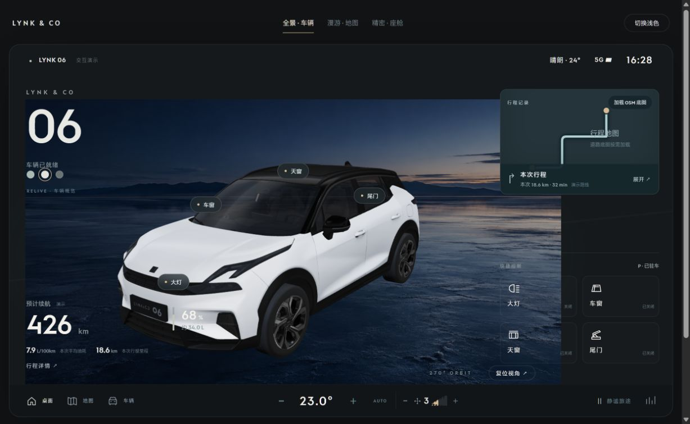

# LYNK 06 Cockpit · 06 座舱

面向领克 06 / Flyme Auto 的 Android 座舱桌面实验项目。

以可旋转车辆为中心，将导航、车辆状态、油耗与行程融入同一个界面，并探索车窗、天窗、尾门、大灯及外置旋钮的交互。Android 是主应用，浏览器 Demo 用于比较布局和验证视觉效果。

[](https://github.com/SakiTomato822/lynk06-cockpit/actions/workflows/build-debug-apk.yml)



> 当前为 0.1.0 开发原型。上图为浏览器设计参考，Android 界面采用原生绘制并嵌入本地车模渲染层，二者并非同一套完整界面。尚未完成实车性能和控车验证。

## 为什么单独建仓库

项目起源于 [autoenergy-fuel-mod](https://github.com/SakiTomato822/autoenergy-fuel-mod)。随着目标扩展为座舱桌面，油耗成为其中一个功能，因此在保留 Git 祖先历史的基础上独立发展。旧项目和已有安装不受本次拆分影响。

| 项目 | 定位 | Android 包名 |
| --- | --- | --- |
| autoenergy-fuel-mod | 油耗、行程记录与分析 | `com.lynk.autoenergyfuel` |
| lynk06-cockpit | 车辆桌面与座舱交互 | `com.lynk.cockpit` |

开发包使用 `com.lynk.cockpit.debug`，可与油耗 App 并排安装。新应用的数据目录独立，不会自动读取旧应用的历史记录。本项目的版本从 `0.1.0` 开始。

## 当前进展

| 能力 | 当前状态 |
| --- | --- |
| 车辆展示 | 本地 3D 车模、270° 环绕、上下视角、受限缩放、车漆切换 |
| 部位交互 | 四窗独立开度浮层、天窗/尾门动画、大灯灯体及地面光束；状态为模拟 |
| 环境 | 晴、多云、雨、雾、雪、模拟车速与痕迹；真实雨量/天气源待接入 |
| 输入 | 触摸、方向键和旋钮输入处理；外置硬件映射待实测 |
| 空调底栏 | 温度、1–7 档风量交互；尚未下发车辆命令 |
| 原厂高德 | `com.geely.map` 导航卡片只读桥接已实现，等待实车验证 |
| 油耗与行程 | 继承读取、采集、曲线、轨迹和 OSM 预览功能，仍作为内部模块维护 |
| 显示适配 | 横屏、系统栏留白、明暗界面；不同车机版本需继续校准 |

导航桥接读取道路名、转向距离、剩余里程/时间、ETA。协议中 103 表示导航中、102 表示未导航；没有独立巡航字段，完整 GPS 轨迹也不能从这些导航卡片字段推导。车道等额外载荷展示尚未完成。

环境决策已提供“有效雨量信号优先，其他情况按天气”的逻辑，当前桌面使用模拟输入。实际传感器数据、天气服务、车辆命令执行及状态确认是后续接入工作。

## Android 构建

需要 JDK 17、Gradle 8.7、Android SDK Platform 34 / Build Tools 34.0.0。最低系统 Android 11（API 30），推荐横屏设备。当前沿用系统安装的 Gradle，未附带 Gradle Wrapper。

1. 在 `local.properties` 配置 `sdk.dir`，或配置 `ANDROID_HOME`。
2. 如需要完整 3D 车模，先从已有的本地缓存导入：

   ```sh
   python tools/prepare_cockpit_assets.py /path/to/lynk06_car_demo
   ```

3. 测试并构建：

   ```sh
   gradle :app:testDebugUnitTest :app:assembleDebug
   ```

APK：`app/build/outputs/apk/debug/app-debug.apk`。

公开仓库没有新增提交展厅模型/贴图/着色器缓存及引擎；导入脚本只复制本地缓存，不会自动下载资源或覆盖项目代码。公开 CI 的 `source-only-debug-apk` 包含原生界面和场景图，但不含 3D 车模缓存，车模区域会显示加载错误。它用于验证构建和基础界面，完整车模版本需准备资源后在本机打包。当前没有正式 Release。

## 浏览器设计参考

```sh
python demos/cockpit/serve.py --assets /path/to/lynk06_car_demo
```

打开 `http://127.0.0.1:8768/cockpit.html`。可切换全景车辆、漫游地图、精密座舱三种布局；车窗长按或右键出现四窗浮层，底部面板可模拟天气、雨量和车速。界面数字和路线为演示数据。OSM 底图按需加载，并保留来源标注。

## 目录与后续方向

- `app/`：Android 桌面及继承的车辆数据、油耗、行程功能。
- `app/src/main/assets/cockpit/`：车模渲染桥接和环境场景资源。
- `demos/cockpit/`：浏览器交互与布局参考。
- `tools/prepare_cockpit_assets.py`：本地资源准备。
- [项目拆分记录](docs/project-split.md)：共同祖先、包名和接口核对。
- [原油耗项目说明](docs/fuel-module-history.md)：旧项目历史文档。

接下来优先完成实车导航订阅、雨量/天气源、视觉与动画校准及性能测量，再把车辆读取、导航和行程存储抽成内部模块。运行流畅度需要在 DHU615G 等目标车机测量，尚无“所有场景不卡”的结论。

本项目为独立研究原型，与领克、吉利、魅族及高德无官方隶属关系。第三方车型、品牌、字体及资源的权利归相应权利人；Git 历史保留了原油耗项目已经提交的资源。
